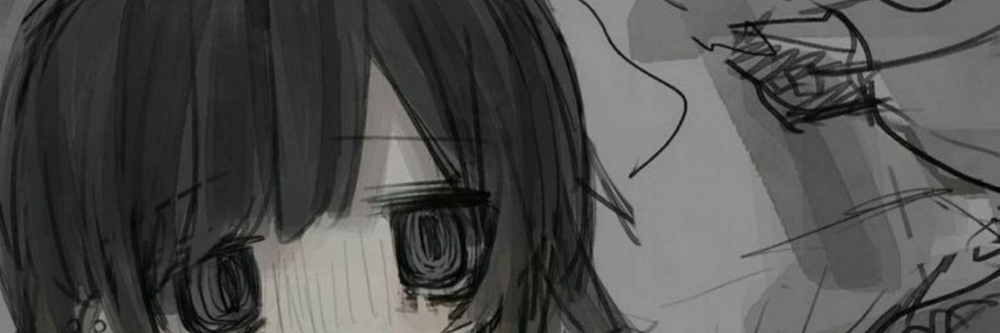

<div align="center">
  
<p align="center">
  
</p>


</div>

```text
╭─[ dev@localhost ]────────────────────────────────────────╮
│                                                          │
│   OS      CachyOS               SHELL    ZSH             │
│   KERNEL  7.2.13                TERM     Kitty           │
│   WM      Hyprland              EDITOR   nvim            │
│   THEME   Custom                FONT     JetBrains Mono  │
│                                                          │
│   CPU     Ryzen 5 5600X         GPU      RTX 3060 Ti     │
│   MEMORY  DDR4 16GB             UPTIME   still running   │
│                                                          │
╰──────────────────────────────────────────────────────────╯
```

<div align="center">

`[ SYSTEM ]` &nbsp; ` [ SOFTWARE ]` &nbsp; ` [ EXPERIMENTS ]`

</div>

---

```console
dev@localhost ~ % ls -la
```

```text
drwxr-xr-x  projects/
drwxr-xr-x  experiments/
drwxr-xr-x  tools/
drwxr-xr-x  .config/
-rw-r--r--  .zshrc
-rw-r--r--  .gitconfig
```

### `01 / selected repositories`

<div align="center">

<a href="https://github.com/YOUR_USERNAME?tab=repositories">
  
</a>
<a href="https://github.com/kojiiris?tab=repositories">
  
</a>

</div>

### `02 / environment`

<div align="center">


</div>

```bash
dev@localhost ~ % git status

On branch main
working tree clean

dev@localhost ~ % _
```

<div align="center">

<sub>Fall seven times, get up eight.</sub>

</div>
